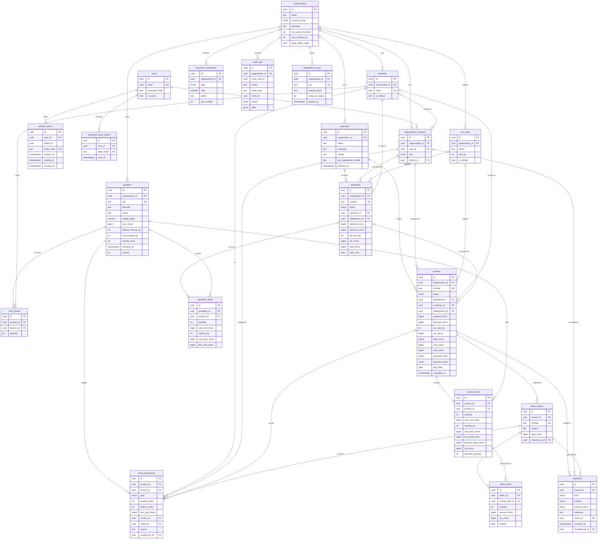

# Velora — Entity Relationship Diagram

Generated by hand from [`backend/prisma/schema.prisma`](../backend/prisma/schema.prisma); column detail is in [`database-design.md`](database-design.md). Only key and distinguishing columns are shown.

## Traceability paths

| Question | Path |
|---|---|
| Why did this product's stock change? | `stock_movements` (type, user, time) → `invoice_id` / `return_id` → document |
| What money was received for this invoice, by whom? | `payments` (kind, method, reference, recorded_by, received_at) |
| What did this sale cost and earn? | `invoice_items.unit_cost_minor`, `unit_price_minor`, `discount_alloc_minor` |
| Who changed this record? | `audit_logs` by `entity_type`, `entity_id` |
| Which quotation produced this invoice? | `invoices.quotation_id` |
