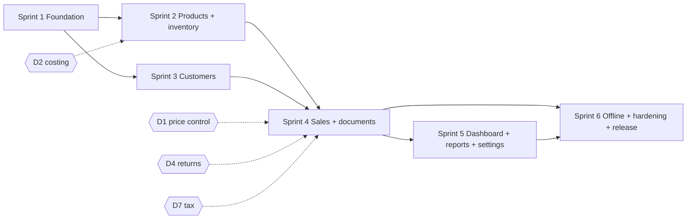

# Velora — Implementation Roadmap

Status at 2026-11-16: **Sprint 0 approved (all defaults in §1 accepted on 2026-11-15). Sprints 1–3 delivered** (product photos, camera scanning and the offline product cache moved from Sprint 2 to Sprint 6) — see `TASKS.md` and `CHANGELOG.md` for what was built, verified and carried over.

## 1. Decisions needed

> **Resolved 2026-11-15:** the owner accepted the recommended default for every decision below (D1–D11). The table is kept as the record of what was decided and what the alternatives were. D7 (tax) still needs the accountant's confirmation before Sprint 4.

Each has a recommended default. Approving "all defaults" is sufficient to start Sprint 1; D1–D4 are the ones that change what gets built.

| # | Decision | Recommended default | Alternative | Impact if changed later |
|---|---|---|---|---|
| **D1** | How do sales staff set prices without learning cost? | They choose a **price** between the product's floor and ceiling; no percentages shown. Managers keep the markup % view. | Keep showing markup % to sales staff (as the reference does) — simpler, but cost is trivially derivable, contradicting "Purchase prices protected". | UI of the price sheet and API field policy; moderate |
| **D2** | Costing method when stock is bought again at a different cost | **Moving weighted average** per product | FIFO lots, or per-piece (serialised) costing — more accurate for unique pieces, needs lot/serial tracking through sales and returns | Schema and profit maths; **high** — decide before Sprint 2 |
| **D3** | May a Manager sell below the minimum markup? | **Yes**, with a mandatory reason, audit-logged. (The reference blocks managers too, though its copy implies otherwise.) | No one can go below minimum; the manager edits the product's minimum instead | Small |
| **D4** | Cancellations and returns (absent in the reference) | Manager-only. Cancel = full reversal (refund + restock) when no returns exist. Returns create a credit note, optionally restock, refund only what exceeds the balance. | Different approval rules, restocking fees, exchange flow, time limits | Rules in Sprint 4; moderate |
| **D5** | Jewellery-specific attributes (metal, purity, stones, making charges) | **Not in v1.** The reference has only a description and weight; gold-rate-based pricing is not evidenced. Barcode is added as an optional field. | Structured attributes and/or making-charge pricing | Catalog schema and pricing; high if pricing is affected |
| **D6** | Suppliers and purchase orders | **Stock receipts with an optional supplier name**; no supplier directory or PO workflow in v1. This changes the brief's Sprint 3 to customers only. | Full supplier module in Sprint 3 | Additive later; low |
| **D7** | Tax | One tax-exclusive rate per document on the discounted total, rates configurable (seeded 5% and 0%) — the reference's behaviour. | Per-line rates, tax-inclusive prices, special schemes | Totals engine; high — needs the owner's accountant to confirm |
| **D8** | Offline invoicing | **Off by default**; offline covers browsing, drafts, quotations, customers and payments. Organizations may enable provisional offline invoices. | On by default | Setting only; low |
| **D9** | Branches | Schema is branch-aware; **UI is single-branch** | Multi-branch UI and transfers | Additive; moderate |
| **D10** | Payment methods | Cash and Bank transfer (as the reference) | Add Card / Cheque / Other | Enum + UI; low |
| **D11** | Hosting and third-party services (unresolved U3) | Vendor-neutral containers + managed PostgreSQL + S3-compatible storage; provider chosen in Sprint 6 | — | Low until Sprint 6 |

## 2. Sprint plan

Sequence adjusted from the brief where discovery showed a better dependency order: **customers move ahead of sales but shrink (no suppliers), document numbering and the idempotency/audit platform land in Sprint 1 because Sprint 2 already needs them, and the settings needed by calculations are seeded from Sprint 1 with their UI in Sprint 5.**

### Sprint 0 — Discovery and architecture ✅
Product audit, flows, design audit and system, screen specifications, business rules, architecture, database schema, API contract, security, offline and testing strategies, backlog.

### Sprint 1 — Foundation
| ID | Item | Depends on |
|---|---|---|
| S1-01 | Repository layout (`backend/`, `mobile/`), tooling, lint, CI pipeline | — |
| S1-02 | Docker Compose dev stack (API, PostgreSQL, MinIO, Mailpit) | S1-01 |
| S1-03 | NestJS + Fastify skeleton: config validation, logging, request id, error filter, response envelope, health | S1-01 |
| S1-04 | Prisma migration #1 incl. SQL constraints, RLS, roles; demo seed | S1-03 |
| S1-05 | Tenant context, transaction helper, money module, pagination, idempotency, audit | S1-04 |
| S1-06 | Auth: login, refresh rotation, logout, reset, change password, `/auth/me`; permission guard; route-registry authorization test | S1-05 |
| S1-07 | Flutter project: flavours, Riverpod, go_router shell with five tabs, Dio client + interceptors, secure storage, Drift setup, localisation | S1-01 |
| S1-08 | Design system: theme, tokens, components, `AsyncValueView`, contrast test, goldens | S1-07 |
| S1-09 | Login, forgot/reset password screens; session handling; role-aware shell | S1-06, S1-08 |
**Exit:** a seeded user signs in on the app against the local API; expired tokens refresh; CI green with isolation and authorization tests.

### Sprint 2 — Products and inventory
| ID | Item | Depends on |
|---|---|---|
| S2-01 | Products API (list/search/filter/sort, create with opening stock, detail, edit, archive), role field policy | S1 |
| S2-02 | Image upload (presigned, verification, re-encode) | S2-01 |
| S2-03 | Stock receipts with weighted-average cost; adjustments; movement ledger API | S2-01, **D2** |
| S2-04 | Screens C1–C6: list, detail, new/edit, receive, adjust, history | S2-01..03 |
| S2-05 | Barcode scanning (search and form) | S2-04 |
| S2-06 | Product cache + delta sync (read side) | S2-01 |
**Exit:** manager can create, receive, adjust; ledger always equals on-hand; Sales sees no cost.

### Sprint 3 — Customers
| ID | Item | Depends on |
|---|---|---|
| S3-01 | Customers API (CRUD, search, duplicate hint, archive, summary) | S1 |
| S3-02 | Screens E1–E3 + reusable customer picker (D4) | S3-01 |
| S3-03 | Customer cache + offline create | S3-01, S2-06 |
(Suppliers: not built — decision D6.)

### Sprint 4 — Sales and documents (delivered 2026-11-16; D7 awaiting accountant)
| ID | Item | Depends on |
|---|---|---|
| S4-01 | Pricing engine (bounds, totals, allocation) + `/pricing/preview`; property tests | S2, **D1, D3, D7** |
| S4-02 | Numbering service; quotations API | S4-01, S3 |
| S4-03 | Invoice issue transaction (stock, number, payment, audit, idempotency); concurrency tests | S4-02 |
| S4-04 | Payments and refunds API | S4-03 |
| S4-05 | Cancellation and returns API | S4-04, **D4** |
| S4-06 | Documents list API; PDF rendering for quotation, invoice, credit note | S4-03 |
| S4-07 | Sell flow screens D1–D6 (price sheet, cart with local draft, customer, payment) | S4-01..03 |
| S4-08 | Documents screens F1–F6 (list, detail, record payment, cancel, return, share/WhatsApp/print) | S4-04..06 |
**Exit:** scenarios 1–12 of the testing strategy pass; a sale can be made, paid, shared, cancelled and returned on device.

### Sprint 5 — Dashboard, reports, settings
| ID | Item | Depends on |
|---|---|---|
| S5-01 | Dashboard API + Home screen | S4 |
| S5-02 | Reports API (summary, by salesperson, payment status, valuation) + CSV | S4 |
| S5-03 | Reports screen with date ranges and charts | S5-02 |
| S5-04 | Business settings, tax rates, team management (API + screens H3, H4) | S1 |
| S5-05 | Sessions/devices list; appearance setting | S1 |

### Sprint 6 — Production readiness
| ID | Item | Depends on |
|---|---|---|
| S6-01 | Outbox and sync engine; sync queue screen; offline quotations/customers/payments; optional provisional invoices | S4, **D8** |
| S6-02 | Security review against the guidelines; fixes | all |
| S6-03 | Performance: indexes, query plans, list virtualization, image caching, start-up time | all |
| S6-04 | Error monitoring, dashboards, alerts, consistency job | all |
| S6-05 | Deployment: staging and production environments, migrations job, backups and restore drill | **D11** |
| S6-06 | Store preparation: icons, splash, signing, privacy declarations, TestFlight / Play internal testing | all |
| S6-07 | End-to-end tests on device farms/emulators; accessibility pass | all |

## 3. Dependency overview

## 4. Technical risks

| # | Risk | Likelihood | Impact | Mitigation |
|---|---|---|---|---|
| R1 | The reference is a demo; real business rules (tax, costing, returns) are inferred, not observed | High | High | Decisions D1–D7 surfaced now; rules isolated in one pricing/stock domain module so changes are local |
| R2 | **This workspace has no Flutter SDK, Android SDK/emulator or macOS.** The Flutter SDK can be installed (download host reachable); the Android SDK host is currently blocked; iOS builds are impossible on Linux | Certain | Medium | Unit, widget and golden tests run here; Android builds once the SDK host is allowed; iOS builds and device tests run in CI on a macOS runner. No device result will be claimed without an actual run |
| R3 | No Docker daemon in this workspace | Certain | Low | PostgreSQL 16 is installed locally for integration tests; Compose files are validated in CI |
| R4 | Weighted-average costing may not match how unique jewellery pieces are accounted | Medium | High | D2 before Sprint 2; `stock_movements.unit_cost_minor` keeps per-receipt cost so a FIFO/lot migration remains possible |
| R5 | Offline invoicing can produce receipts the server later rejects | Medium (if enabled) | High | Off by default; provisional labelling; mandatory resolution queue |
| R6 | Prisma limitations for locking and constraints | Medium | Medium | Raw SQL confined to repositories; constraint and concurrency tests |
| R7 | Cost confidentiality regressions (a new field leaks to Sales) | Medium | High | Serializer driven by schema markers + contract test on every endpoint |
| R8 | Server-side PDF layout and fonts (Arabic, if required later) | Medium | Medium | Spike at the start of S4-06; fonts bundled |
| R9 | WhatsApp cannot receive an attachment via deep link | Certain | Low | System share sheet delivers the PDF; the `wa.me` text link is kept as a shortcut |
| R10 | Scope: 50 API operations and ~30 screens | Medium | Medium | P0/P1/P2 priorities in the feature matrix; returns, CSV, barcode and offline invoices are the first candidates to defer |

## 5. Unresolved questions

| # | Question | Needed by |
|---|---|---|
| U1 | Is Velora one company's internal tool or a product sold to many jewellers (self-service sign-up, billing, plans)? The schema is multi-tenant; no sign-up or billing flow is planned | Sprint 5 |
| U2 | Languages: English only, or Arabic (RTL) as well? Layouts are RTL-safe; translation and Arabic PDF fonts are not planned | Sprint 4 |
| U3 | Hosting provider, email provider, error-monitoring vendor, Apple/Google developer accounts | Sprint 6 |
| U4 | Legal content of invoices in the target jurisdiction (mandatory fields, "Tax Invoice" wording, numbering rules, credit-note requirements) | Sprint 4 |
| U5 | Data retention periods for financial records and audit logs | Sprint 6 |
| U6 | Should existing demo data (browser localStorage) be migrated? Assumed no — it is seed data only | Sprint 1 |
| U7 | Do sales staff need to see each other's documents or customers' full history? Assumed own documents only, shared customer directory | Sprint 3 |
| U8 | Is a quantity always whole pieces? (The reference offers "pcs" as a weight unit, hinting some items may be sold by weight.) Assumed whole pieces | Sprint 2 |
