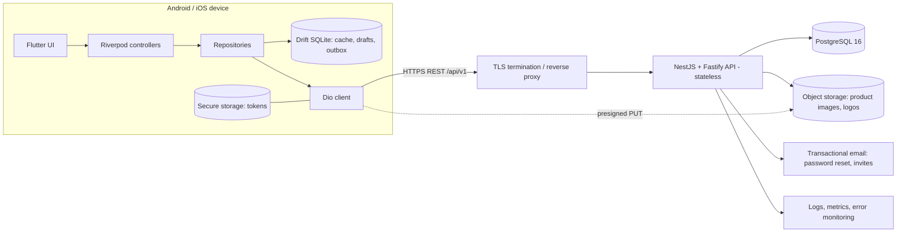
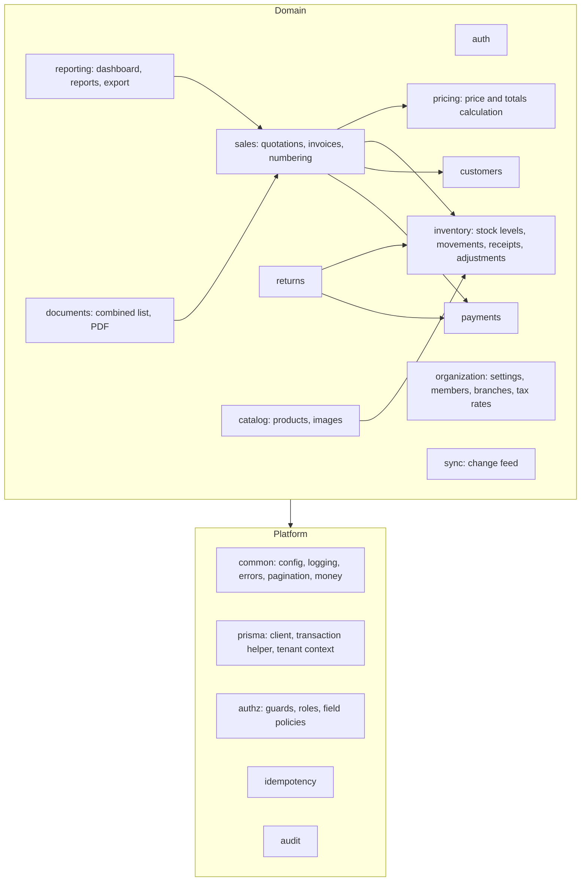
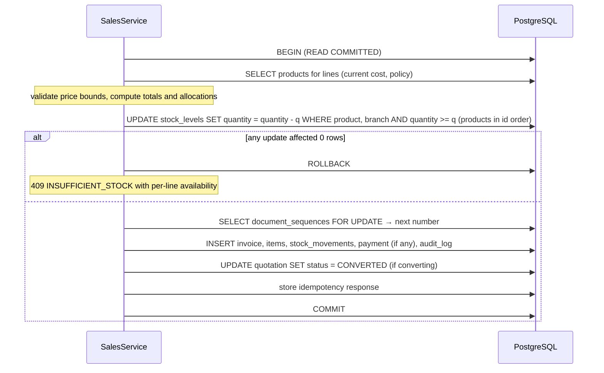
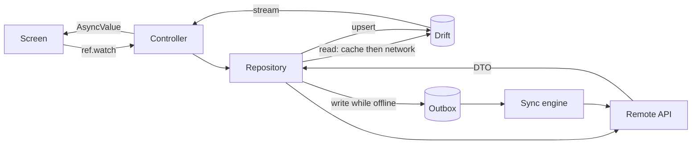
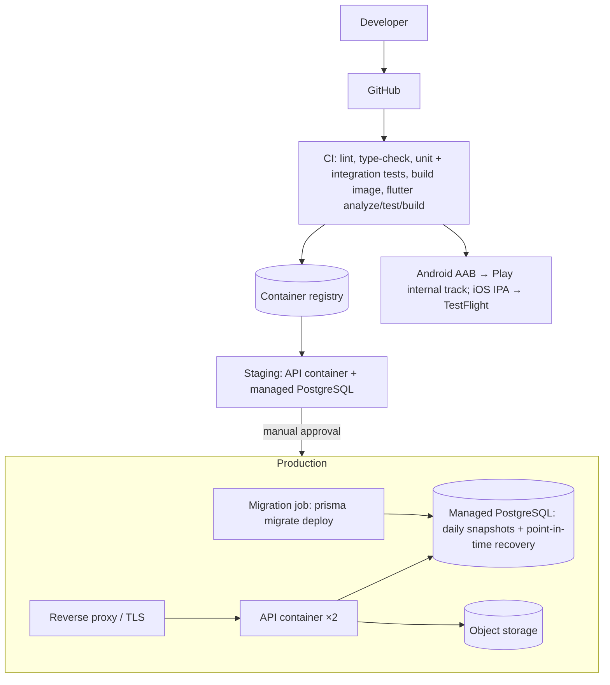
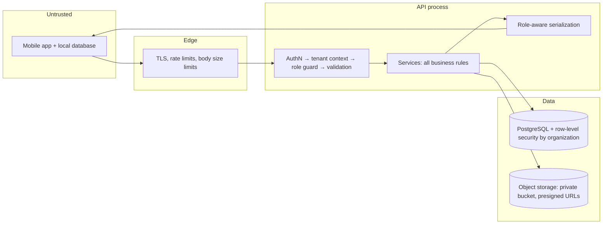

# Velora — System Architecture

Status: **accepted** with the Sprint 0 approval (2026-11-15). Decisions are recorded as ADRs in [`architecture-decision-records/`](architecture-decision-records/).

## 1. Context

The reference is a browser-only demo with no server ([`product-discovery.md`](product-discovery.md) §1). The production system therefore consists of two new deliverables: a Flutter application for Android and iOS, and a backend that owns all business rules, money and stock.

## 2. Stack and trade-offs

| Layer | Choice | Alternatives considered | Why |
|---|---|---|---|
| Mobile | Flutter 3 / Dart 3, Material 3 with Velora theme | — (given) | |
| State | **Riverpod 2** (code-generated providers) | Bloc | Less boilerplate for async data + DI in one mechanism; compile-safe |
| Navigation | **go_router** with `StatefulShellRoute` | auto_route | Official, supports per-tab stacks, deep links and redirect guards |
| HTTP | **Dio** + interceptors | `http` | Interceptors for auth refresh, idempotency keys, error mapping |
| Models | **Freezed** + `json_serializable` | hand-written | Immutable value types and unions for state; generated JSON |
| Local DB | **Drift** (SQLite) | Isar, Hive | Relational cache and an ordered outbox need transactions and queries; Drift is typed and migratable |
| Secrets | **flutter_secure_storage** (Keychain / Keystore) | shared_preferences | Tokens must not be in plain storage |
| Backend | **NestJS on Fastify**, TypeScript strict | Express adapter; Go; Django | Modular structure maps to the domain; Fastify for throughput and schema hooks; one language family for a small team |
| API | **REST + OpenAPI 3.1**, `/api/v1` | GraphQL, tRPC | Simple caching, idempotency and offline replay semantics; contract usable from Dart |
| Database | **PostgreSQL 16** | MySQL | Transactions, row locks, `CHECK` constraints, row-level security, `citext` |
| Data access | **Prisma** (+ raw SQL for locking statements and constraints) | Drizzle, TypeORM, Kysely | Schema-as-code and migrations; the few statements Prisma cannot express (`FOR UPDATE`, conditional stock update, RLS, `CHECK`) are isolated in repository methods and SQL migrations |
| Files | S3-compatible object storage, presigned uploads | DB blobs (reference used base64 in localStorage) | Images out of the database and API path |
| PDF | Server-side rendering (`pdfmake`) | On-device (`pdf` package) | One canonical document for every client; device caches the result |
| Cache / queue | **None in v1** | Redis | No workload needs it: rate limits are per-instance + DB-backed login throttling; idempotency lives in PostgreSQL. Add Redis when running more than ~2 API instances or adding background jobs (ADR-0002) |
| Architecture | **Modular monolith** | Microservices | One team, one database, strong transactional coupling between sales, stock and payments |

Main risks accepted: Prisma's limits around locking (mitigated by raw SQL in a small repository layer); server-side PDF needs fonts and a layout maintained separately from the app UI.

## 3. High-level architecture



## 4. Backend

### 4.1 Modules



Rules:
- A module exposes a service interface; other modules never touch its tables directly. Cross-module writes that must be atomic (invoice + stock + payment) are orchestrated by the `sales` application service inside one transaction passed down explicitly.
- **Layers inside a module:** controller (HTTP, DTO validation, serialization by role) → application service (use case, transaction) → domain functions (pure calculations, e.g. `pricing/totals.ts`, unit-tested exhaustively) → repository (Prisma / SQL).
- **Money** is a `bigint` in domain code; a single `money.ts` holds rounding and allocation.

### 4.2 Request pipeline

```mermaid
flowchart LR
  R[Request] --> RID[Request id + structured log]
  RID --> RL[Rate limit]
  RL --> AU[JWT auth guard]
  AU --> TN[Tenant context: org id, member id, role, branch]
  TN --> RB[Role guard]
  RB --> VAL[DTO validation - whitelist, reject unknown]
  VAL --> IDM[Idempotency interceptor - mutating financial routes]
  IDM --> H[Handler → service → transaction]
  H --> SER[Role-aware serializer - strips cost fields for SALES]
  SER --> AUD[Audit writer - inside the transaction]
  AUD --> RESP[Response envelope / error filter]
```



### 4.3 Transactions and concurrency

Issuing an invoice is the critical path:



- The conditional `UPDATE` is the concurrency control for stock: two simultaneous sales of the last piece cannot both succeed. Rows are updated in a deterministic order to avoid deadlocks.
- Payments, returns and cancellations lock the invoice row (`SELECT … FOR UPDATE`) before reading the balance.
- Product edits use optimistic concurrency (`version` column).
- Deadlock or serialization failures are retried up to three times by the transaction helper.

## 5. Flutter application

### 5.1 Structure (feature-first)

```
lib/
  main_dev.dart  main_staging.dart  main_prod.dart      # flavours → AppConfig
  app/
    app.dart                 # MaterialApp.router
    config/                  # AppConfig (api base url, flavour), env
    router/                  # GoRouter, routes, guards
    theme/                   # ThemeData light/dark, VeloraTokens
    l10n/                    # ARB files
  core/
    api/                     # Dio client, interceptors (auth, idempotency, error), ApiResult
    auth/                    # token store, session controller
    db/                      # Drift database, tables, DAOs
    errors/                  # Failure types, error catalogue → messages
    money/                   # Money value type, formatting, mirrored calculations
    sync/                    # outbox, sync engine, connectivity
    utils/
    widgets/                 # design-system components (AsyncValueView, MoneyField, StatusPill …)
  features/
    auth/  dashboard/  products/  inventory/  customers/
    sell/  documents/  payments/  reports/  settings/
      data/                  # DTOs, remote API, local DAO, repository implementation
      domain/                # entities, repository interface, pure logic
      presentation/          # screens, widgets, controllers (Riverpod notifiers)
```

Adaptations from the brief's draft: `sales` is split into `sell` (cart → issue) and `documents` (quotations and invoices list/detail, returns, cancellation); `payments` is its own small feature used by both; `settings` covers business settings and team; no `shared/` folder — cross-feature code lives in `core/`.

### 5.2 Rules

- Widgets never call Dio or Drift. Flow: widget → controller (`AsyncNotifier`) → repository interface → remote/local data sources.
- Repositories return domain entities or a typed `Failure`; controllers expose `AsyncValue<T>`; screens render it through `AsyncValueView`.
- A `domain/` layer is added only where there is logic or an offline abstraction (sell, documents, products, customers). Read-only features (dashboard, reports) use `data/` + `presentation/` — no pass-through use-case classes.
- Dependency injection is Riverpod providers; tests override them.
- The role is part of session state; the router redirects and widgets branch on a `Permissions` object, but the server remains the enforcement point.

### 5.3 Data flow



## 6. Authentication flow

- Login with email + password → **access token** (JWT, 15 minutes; claims: user, organization, member, role, branch) and **refresh token** (opaque 256-bit random, 30 days, stored hashed, single use).
- Refresh rotates the token within a *family*. Presenting an already-rotated token revokes the family (theft detection) and forces login.
- The Dio auth interceptor refreshes once (single flight) on `401 TOKEN_EXPIRED` and replays queued requests. On `SESSION_REVOKED` it clears tokens, keeps local drafts and the outbox, and routes to login.
- Role or membership changes and deactivation revoke the user's token families immediately; the 15-minute access token is the maximum staleness.
- Sequence diagram: [`user-flow-map.md`](user-flow-map.md) §6. Details: [`security-guidelines.md`](security-guidelines.md).

## 7. Offline synchronization (summary)

Full design: [`offline-sync-strategy.md`](offline-sync-strategy.md).

- **Read:** products, customers and recent documents are cached in Drift and refreshed by a delta feed (`GET /sync/changes?since=`).
- **Write:** drafts are local only. Quotations, new customers and payments on existing invoices may be queued in an outbox with client-generated IDs and idempotency keys. Invoices offline only if the organization enables it; stock is always confirmed by the server.
- **Conflicts are surfaced, never auto-resolved** for anything involving money or stock.

## 8. Deployment



- **Environments:** `dev` (Docker Compose: API + PostgreSQL + MinIO + Mailpit), `staging`, `production`. Configuration only through validated environment variables ([`ENVIRONMENT.md`](../ENVIRONMENT.md)); no secrets in the repository or in app binaries.
- **Migrations:** forward-only Prisma migrations run as a release step before the new API version starts; destructive changes use expand → migrate → contract across two releases.
- **Backups:** managed PostgreSQL with point-in-time recovery, daily snapshots retained 30 days, quarterly restore drill.
- **Observability:** structured JSON logs (pino) with request id, user and organization; health endpoints (`/health/live`, `/health/ready`); error monitoring (Sentry or equivalent) in API and app; basic metrics (latency, error rate, DB pool).
- The hosting provider is not yet chosen (unresolved question U3); nothing above depends on a specific vendor.

## 9. Security boundaries



- The app is untrusted: every rule is re-validated on the server; client-computed totals are ignored.
- Tenant isolation is enforced twice: the tenant context scopes every query, and PostgreSQL row-level security rejects anything that slips through (ADR-0004).
- Field-level confidentiality (cost, markup, profit) is enforced in the serializer per role, with tests asserting absence.
