# Velora — User Flow Map

Two kinds of diagram appear here:

- **Reference (as-is):** what the web demo does today, verified in the audit.
- **Target (mobile):** the flow the Flutter app and API will implement. Differences are deliberate and explained in [`design-audit.md`](design-audit.md) and [`product-discovery.md`](product-discovery.md).

## 1. Navigation

### Reference (as-is)

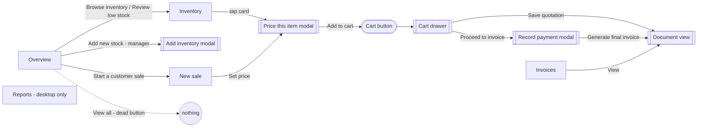

### Target (mobile)

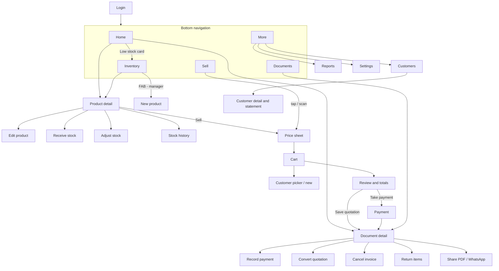

## 2. Inventory management

### Reference (as-is)

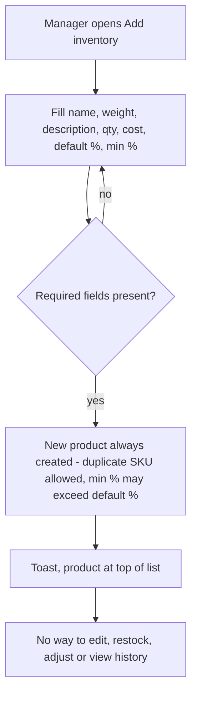

### Target

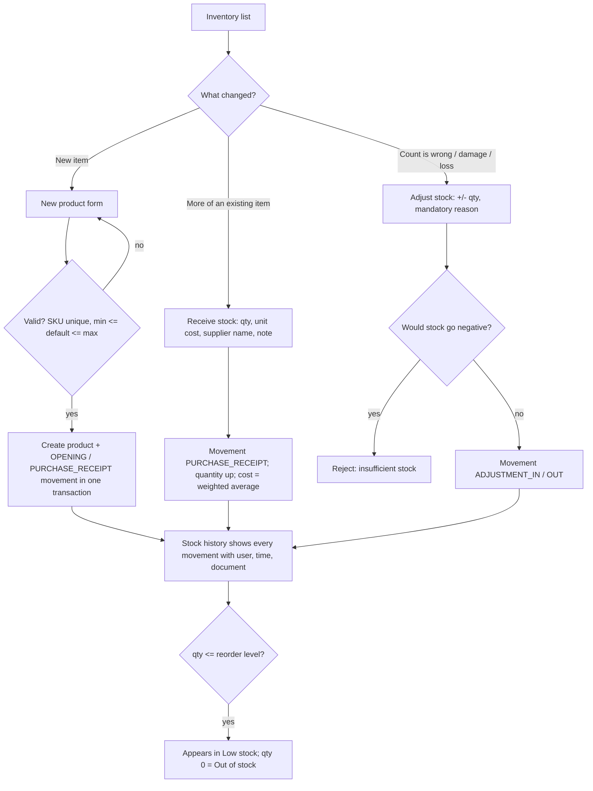

## 3. Sale → quotation or invoice

### Reference (as-is)

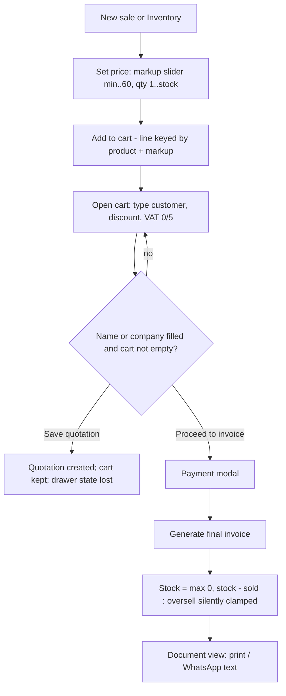

### Target

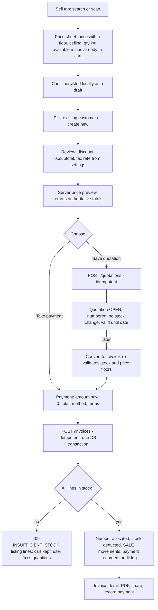

## 4. Payments and outstanding balances

Reference: payment is captured once at invoice creation and can never be added to. Target:

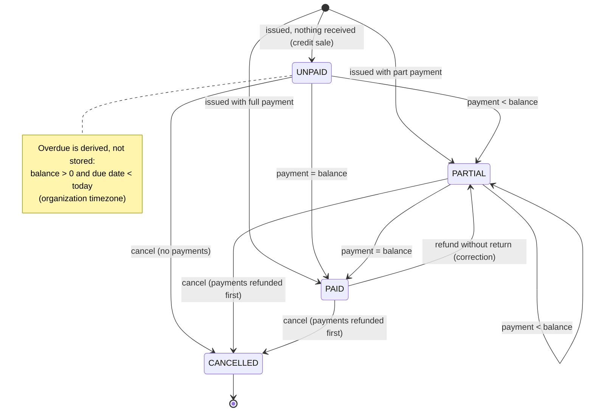

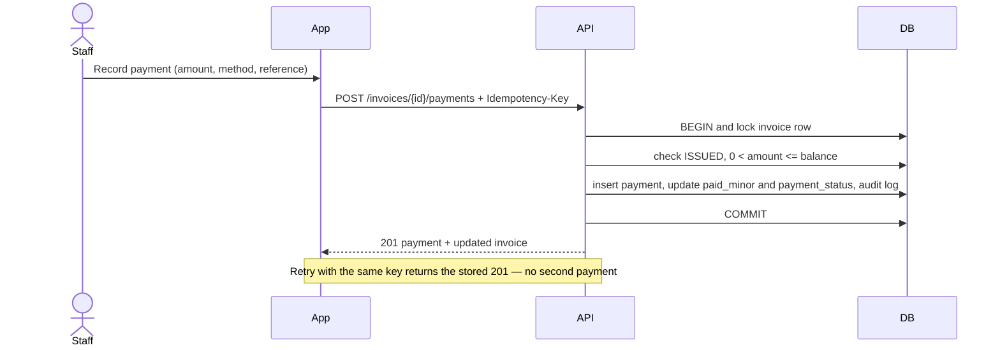

## 5. Cancellation and returns (new — not in the reference)

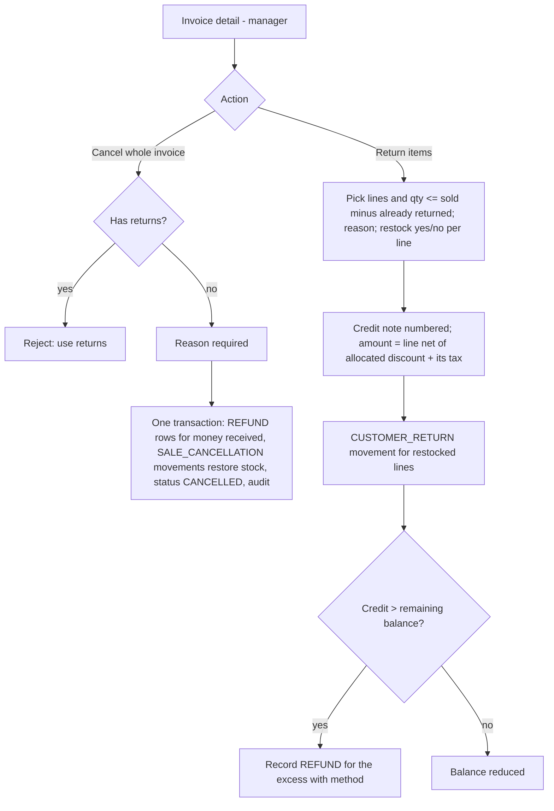

## 6. Authentication

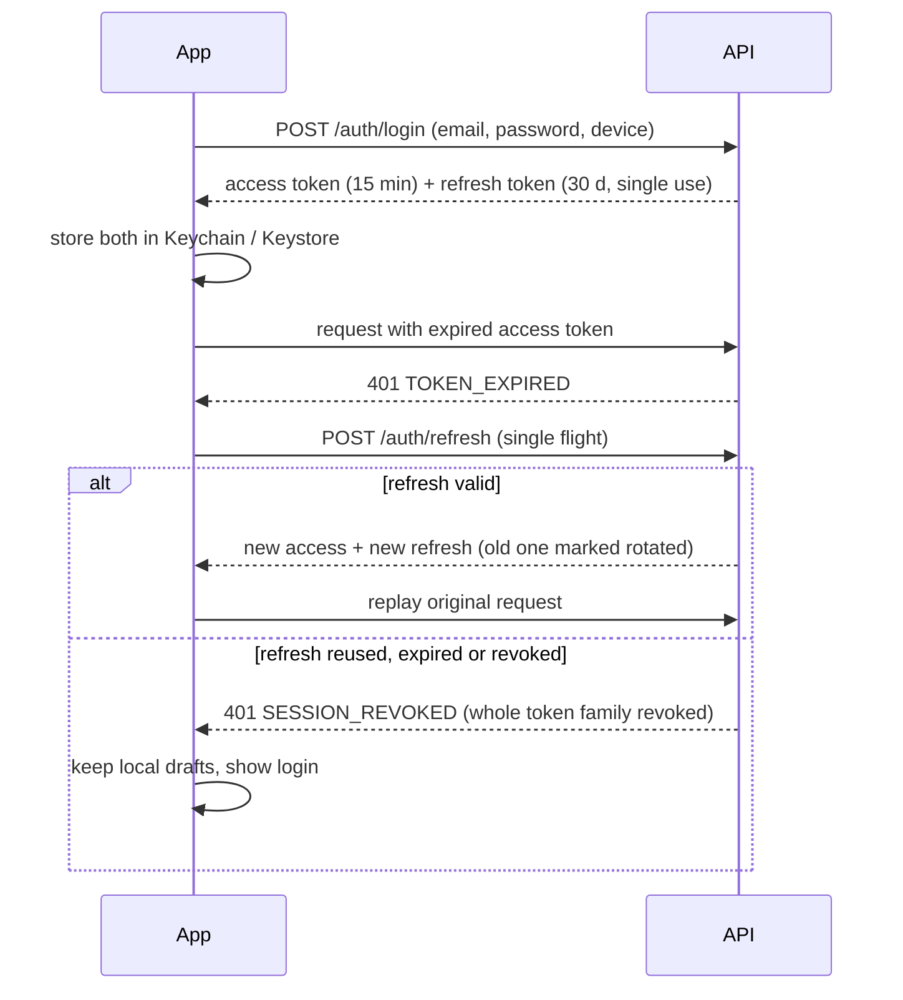

## 7. Offline sale synchronization

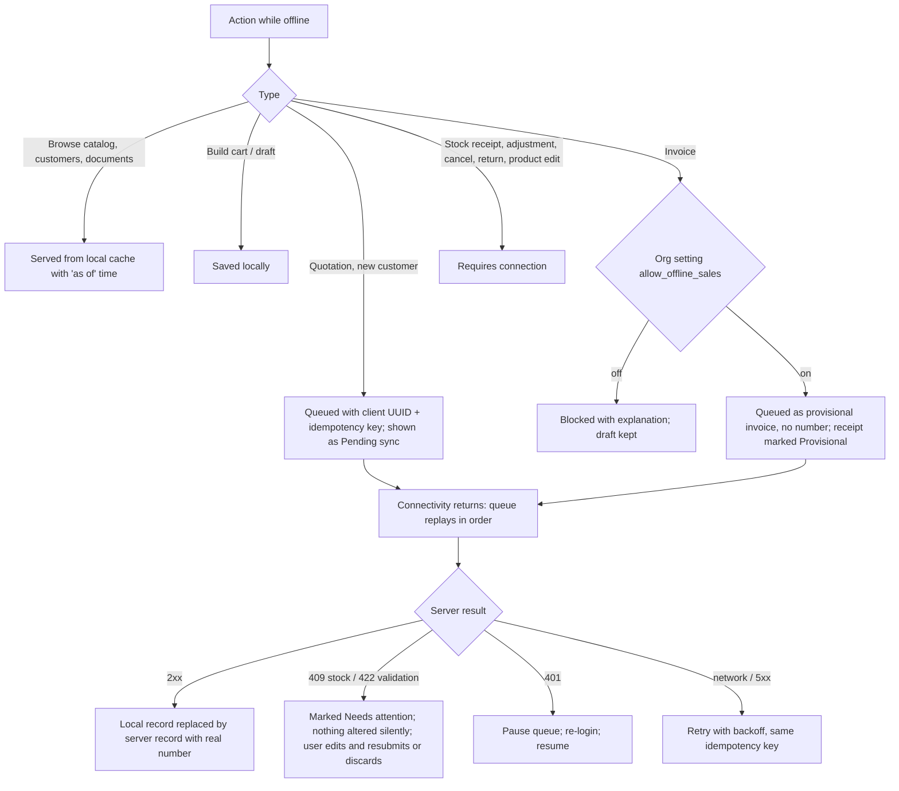
