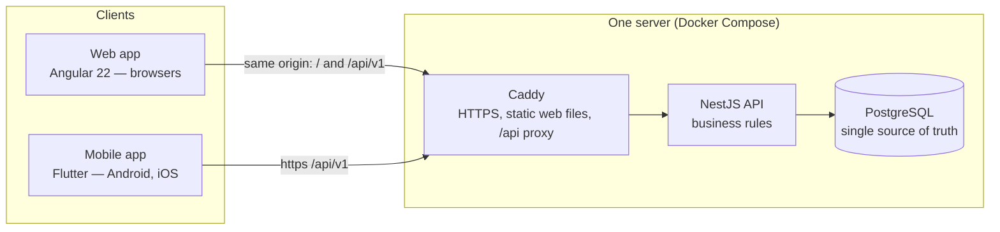

# Velora Web — Frontend Architecture

**Status:** Proposed (Sprint W0). Decision record: `web-frontend-architecture-decision.md`. State: `web-state-management.md`. API: `web-api-integration.md`.

## 1. Context



Both clients call the same REST API. Neither holds business rules the API does not enforce. The web app is online-only; offline working is a mobile capability.

## 2. Project structure

```
web/
  angular.json, package.json, tsconfig*.json     strict TypeScript, strict templates
  proxy.conf.json                                 dev: /api → http://localhost:3000
  playwright.config.ts, e2e/                      end-to-end tests against the real API
  src/
    main.ts                                       bootstrapApplication with app.config.ts
    styles/                                       tokens.css (light/dark), material-theme.scss, typography, utilities
    environments/                                 apiBaseUrl only — no secrets, ever
    app/
      app.config.ts                               zoneless, router, HttpClient + interceptors, Material defaults
      app.routes.ts                               top-level routes, all features lazy
      core/                                       singletons, imported by features, never the reverse
        api/                                      schema.d.ts (generated), api.ts, envelope, api-failure, interceptors/
        auth/                                     session.store.ts, auth.api.ts, guards (signedIn, permission), web-lock refresh
        entity-versions.ts                        invalidation counters (state doc §3.2)
        money/                                    money.ts (format/parse integer minor units), money.pipe.ts
        dates/                                    organization-time-zone formatting
        preferences.store.ts                      theme, sidebar, table columns
        errors/                                   failure → message table, global error handler
      layout/                                     shell (sidebar, top bar, account menu), breadcrumbs, global search
      shared/
        ui/                                       design-system components (see web-component-inventory.md)
        forms/                                    money-input, percent-input, quantity-stepper, form-field helpers
        table/                                    data-table, column defs, load-more, responsive card mode
      features/
        auth/          sign-in, forgot password, reset/set password
        dashboard/
        inventory/     products table, product detail/form, receive, adjust, stock history
        customers/     table, detail (with document history), form, picker dialog
        sell/          sale workspace, sale.store.ts, price editor, payment step
        documents/     documents table, invoice detail, quotation detail, payment/refund/cancel dialogs, return page
        reports/
        settings/      business, tax rates, team
        account/       change password, devices, appearance
```

Each feature folder has the same shape: `routes.ts` (lazy entry, route-level providers), `data/` (typed API service + resources), `state/` (SignalStore where needed), `pages/` (routed, smart), `components/` (presentational: inputs/outputs only, `OnPush`). A feature may import from `core/` and `shared/`, never from another feature; cross-feature needs (customer picker used by Sell) are exported through that feature's public `index.ts`.

## 3. Rendering and change detection
- Zoneless, all components `OnPush`, signals for template state, `@if`/`@for`/`@defer` control flow.
- `@defer` for heavy, below-the-fold or rarely used parts (report sections, PDF viewer, dialogs' content).
- No server-side rendering: the app sits behind sign-in, so SSR brings no SEO value and would require server-side token handling.

## 4. Routing and guards

| Path | Guard | Notes |
|---|---|---|
| `/sign-in`, `/forgot-password`, `/reset-password?token=` | signed-out only (reset also works signed in) | `reset-password` accepts invitations too (B2) |
| `/` → `/dashboard` | signed in | |
| `/inventory`, `/inventory/:id` | signed in | |
| `/inventory/new`, `/inventory/:id/edit`, `/inventory/history` | `product.manage` / `inventory.read` | |
| `/sell` | `sale.create` | Workspace; `?quotation=` to convert |
| `/documents`, `/documents/invoices/:id`, `/documents/quotations/:id` | signed in | Sales role sees own documents (server-enforced) |
| `/documents/invoices/:id/return` | `invoice.return` | |
| `/customers`, `/customers/new`, `/customers/:id`, `/customers/:id/edit` | `customer.read` / `customer.write` | |
| `/reports` | `report.read_own` | Sections vary by role |
| `/settings/business`, `/settings/tax-rates` | `settings.read` (edit: `settings.manage`) | |
| `/settings/team` | `team.read` (edit: `team.manage`) | |
| `/account/password`, `/account/devices` | signed in | Appearance is in the account menu |
| `**` | — | Not found page |

Guards only improve the experience; the API refuses anything the role may not do. A refused request shows the "You don't have access" state, never a blank page.

## 5. Cross-cutting
- **Errors:** interceptor → `ApiFailure`; feature code maps it with the shared message table (codes identical to mobile `failure_messages.dart`); unexpected errors reach a global `ErrorHandler` that shows a toast with the request reference and logs to the console (an error-reporting service can be plugged in at deployment).
- **Confirmation of risky actions:** cancel invoice, returns, refund, archive, remove access, discard sale — one `ConfirmDialog` with the consequence spelled out.
- **Accessibility:** WCAG 2.2 AA target; keyboard-complete; focus management in dialogs and after navigation; `axe` checks in end-to-end tests.
- **Internationalisation:** English only at launch; strings marked with `$localize`/`i18n` from the start so a translation (Arabic, RTL) can be added without touching templates. Number, currency and date formatting via `Intl` with the organization's settings.
- **Security:** no secrets in the bundle; access token in memory; refresh token in an HttpOnly cookie (B1); strict Content-Security-Policy from Caddy (`default-src 'self'`, no inline scripts; Angular builds are CSP-compatible); Angular's built-in sanitisation, no `innerHTML` with server data; links built with `URL`, external links `rel="noopener"`.
- **Performance budgets:** initial JS ≤ 250 kB gzip, each lazy feature ≤ 120 kB gzip, LCP ≤ 2.5 s on a mid-range laptop over 4G; enforced by `angular.json` budgets and a Playwright check.

## 6. Build and delivery
- `ng build` produces static files. They are copied into the Caddy container (or a volume) and served from `/`; `/api/*` is proxied to the API (B3). One image per release, built in CI.
- Environments differ only in `apiBaseUrl` (normally `/api/v1` everywhere).
- CI: lint, type-check, unit/component tests, build with budgets, OpenAPI types up to date, Playwright against the API started from the same commit.
