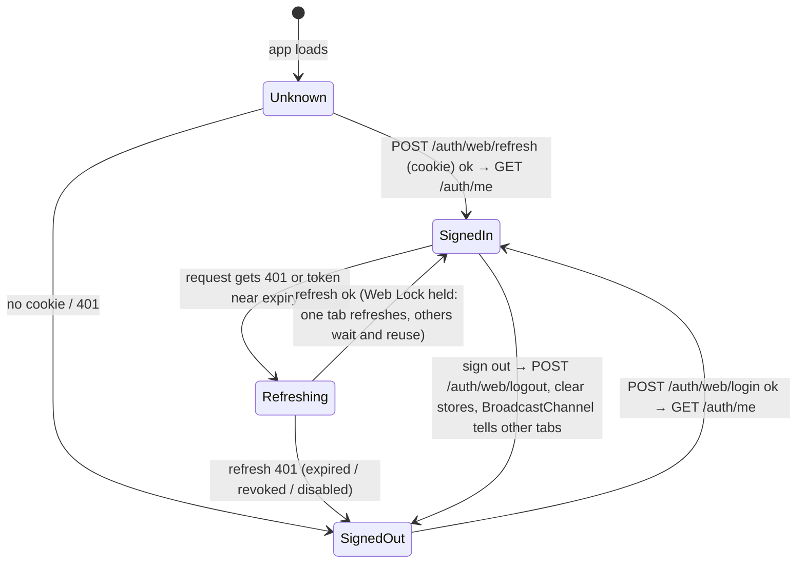
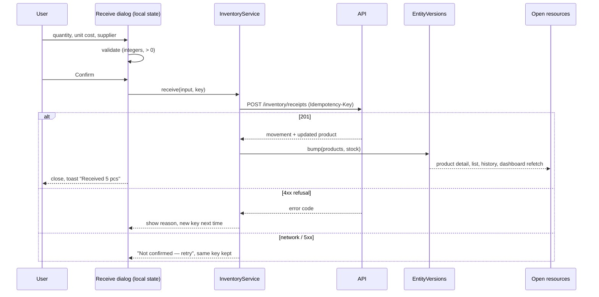

# Velora Web — State Management

**Status:** Proposed (Sprint W0). Applies to `web/`. Companion to `web-frontend-architecture.md`.

## 1. Principles

1. **The server owns every business fact.** Products, stock, customers, documents, payments, figures and settings are read from the API and never edited "locally first". The web app keeps a *view* of them, not a copy to reconcile.
2. **Each piece of state has exactly one home** (table below). Nothing is copied into a global store "just in case".
3. **The URL owns navigational state** — search text, filters, sort, date range, selected tab. A link or a reload restores the same view; the back button works.
4. **No optimistic updates for money or stock.** Every financial or stock change waits for the server's answer, which then replaces what is shown. Optimistic updates are allowed only for pure preferences (theme).
5. **One intended change = one idempotency key**, kept until the server has answered with success or a definite refusal (see §6).

## 2. Where state lives

| Category | Examples | Home | Lifetime |
|---|---|---|---|
| **A. Server state** | product list page, product detail, customers, documents, invoice detail, dashboard, reports, organization, team, tax rates | `httpResource` / `rxResource` inside a feature service or SignalStore, keyed by signals | While a screen using it is open; re-fetched when its key or an entity version changes |
| **B. Global application state** | signed-in user, organization, role, permissions, organization settings (currency, time zone, default tax), access token, theme | `SessionStore` and `PreferencesStore` (SignalStore, `providedIn: 'root'`) | Application lifetime; session cleared on sign-out |
| **C. Feature state** | sale in progress (cart, customer, discount, tax rate, notes, quotation being converted), idempotency keys of pending submissions, list filters mirrored from the URL | Feature SignalStore provided on the feature's route (`SaleStore`, `DocumentFiltersStore`…) | Route lifetime, except the cart, which is also saved per user in `localStorage` |
| **D. Local UI state** | dialog open, selected tab, row expanded, field focus, sidebar collapsed | Component `signal()` | Component lifetime (sidebar collapsed: `PreferencesStore`) |

What is deliberately **not** stored anywhere in the browser: refresh tokens (HttpOnly cookie, invisible to JavaScript), passwords, other users' data after sign-out.

## 3. Server state

### 3.1 Reading
Each feature exposes typed read resources built on `httpResource`, keyed by signals:

```ts
// features/inventory/data/products.resource.ts (sketch)
readonly query = signal<ProductQuery>({ q: '', stockStatus: null, sort: 'name' });
readonly products = httpResource<Page<Product>>(() => ({
  url: '/products',
  params: toParams(this.query()),
  // reading the version makes the resource refetch after any product or stock change
  context: withVersion(this.versions.products()),
}));
```

- **Loading / error / empty** come from the resource (`isLoading`, `error`, `value`). Every screen renders all three; `error` is normalised to `ApiFailure` (§7).
- **Stale responses** cannot overwrite newer ones: when the key changes, `httpResource` cancels the previous request.
- **Debounced search:** the search box writes to the URL after 300 ms; the query signal follows the URL.
- **Pagination** is keyset (cursor) everywhere — the API gives `nextCursor`/`hasMore`, never page numbers or totals (except product counts per stock status). Lists show **"Load more"** (and infinite scroll on touch). Accumulated pages live in the feature store; changing any filter resets them.
- **Sorting and filtering are always server-side**, limited to what the API supports (see the matrix in `web-api-integration.md`). No list is ever downloaded whole to filter in the browser.

### 3.2 Invalidation — the `EntityVersions` service
A root service holds one counter signal per entity type:

```
products · stock · customers · documents · payments · organization · taxRates · team · sessions
```

Every successful mutation bumps the versions it affects, in one place per mutation:

| Mutation | Bumps |
|---|---|
| Create / edit / archive product | products |
| Receive or adjust stock | products, stock |
| Create invoice | documents, stock, products, customers (balances), dashboard via documents |
| Record payment, refund | documents, payments, customers |
| Cancel invoice, return items | documents, payments, stock, products, customers |
| Create quotation / cancel quotation | documents |
| Customer create / edit / archive | customers |
| Organization settings | organization (+ session profile refresh) |
| Tax rates | taxRates (+ session profile refresh: default rate) |
| Team | team |

Resources read the versions they depend on, so anything on screen refetches; anything not on screen fetches fresh when next opened. This replaces "tag invalidation" from RTK Query with ~40 lines and no cache to get wrong. Dashboard and reports read several versions.

### 3.3 Caching
Deliberately minimal: a resource lives as long as the screen that uses it. Going back to a list refetches it (the URL restores filters and scroll position from the router's scroll restoration). For financial data at this scale, always-fresh is the correct default. **Fallback:** if measured navigation latency becomes a problem, adopt TanStack Query for Angular for category A only — the read services are the single place that would change.

### 3.4 Concurrent and failed requests
- Reads: superseded reads are cancelled; a failed read shows the error with **Try again** (no silent automatic retries of reads that failed for a reason other than the network).
- Network failures and 5xx on **safe** requests (GET) are retried once after 1 s by the HTTP layer; never for POST/PATCH/DELETE.
- Writes are never retried automatically; the user retries with the **same idempotency key** (§6).

## 4. Global application state

### `SessionStore`
```ts
type SessionState =
  | { status: 'unknown' }                    // app starting, trying the refresh cookie
  | { status: 'signedOut'; reason?: 'expired' | 'signedOut' | 'disabled' }
  | { status: 'signedIn'; me: Me; accessToken: string; expiresAt: number };
```
Exposes `me`, `can(permission)`, `settings`, `money` (a formatter built from the organization's currency) as computed signals. The access token is in memory only.

### `PreferencesStore`
Theme (`system | light | dark`), sidebar collapsed, table column visibility per table — `localStorage`, per browser, non-sensitive, wrapped in try/catch.

## 5. Feature state

### `SaleStore` (route-provided on `/sell`, persisted per user)
```ts
interface SaleState {
  lines: CartLine[];          // productId, name, sku, quantity, unitPriceMinor, belowMinimumReason?
  customer: CartCustomer | null;
  discountMinor: number;      // integer minor units
  taxRateId: string | null;
  notes: string | null;
  quotation: { id: string; number: string } | null;   // when converting
  submission: Submission;     // see §6
}
```
- Derived: `preview` = `httpResource` on `POST /pricing/preview` keyed by lines/discount/tax (debounced 250 ms) — **totals come only from the server**; `canTakePayment` = customer chosen ∧ preview valid ∧ not submitting.
- Persisted to `localStorage` under `velora.cart.<userId>` (no cost fields stored), removed on sign-out and after a successful sale. The web cart and a phone's cart are independent.

### Filter stores
Thin SignalStores that map URL query parameters ↔ typed filter objects for products, customers, documents, stock history, reports. The URL is the source; the store gives typed access and defaults.

## 6. Preventing duplicate financial submissions

```ts
type Submission =
  | { state: 'idle' }
  | { state: 'confirming'; key: string }
  | { state: 'sending'; key: string }
  | { state: 'failed'; key: string; failure: ApiFailure; retryable: boolean };
```

- A key (UUID v4) is created when the user opens the confirmation for an operation, and **kept** across retries of that same operation: network error, timeout, 5xx, or `REQUEST_IN_PROGRESS`.
- A key is **discarded** (new one next time) after success, or after a definite refusal (400/409/422), or when the user changes the input.
- While `sending`, the confirm button is disabled and shows progress; a second click does nothing; closing the dialog is blocked until an answer arrives (or the user explicitly abandons after a timeout, which keeps the key for a later retry).
- Applies to: create invoice, create quotation, record payment, refund, cancel invoice, return items, receive stock, adjust stock, create product, create customer.

## 7. Errors and expired sessions
- The HTTP layer turns every error into a typed `ApiFailure` (network, timeout, unauthorized, forbidden, notFound, rateLimited, validation{fields}, business{code, details}, server{requestId}) — same taxonomy as the mobile app — and screens map codes to wording through one table.
- **401 on a request:** the interceptor pauses, refreshes once (single flight across tabs, §8), replays the request. If the refresh fails: `SessionStore → signedOut('expired')`, the router goes to sign-in with a return URL, **the sale in progress stays saved**.

## 8. State flows

### 8.1 Authentication


### 8.2 Inventory update (receive or adjust stock)


### 8.3 Sale creation
```mermaid
sequenceDiagram
  participant U as User
  participant St as SaleStore
  participant API
  participant V as EntityVersions
  U->>St: add products, quantities, prices, customer, discount, tax
  St->>API: POST /pricing/preview (debounced, latest wins)
  API-->>St: totals + per-line issues (stock, price bounds)
  St-->>U: server totals; problems on each line
  U->>St: Take payment (amount, method, reference, credit days)
  St->>St: submission = confirming(key K)
  U->>St: Confirm
  St->>API: POST /invoices (Idempotency-Key K)
  alt 201 (or replay)
    API-->>St: invoice with number, status
    St->>V: bump(documents, stock, products, customers)
    St->>St: clear cart + saved copy; submission idle
    St-->>U: navigate to invoice INV-…
  else INSUFFICIENT_STOCK / PRICE_* / PRODUCT_UNAVAILABLE
    API-->>St: refusal with details
    St->>St: keep cart; new key next time; refresh preview
    St-->>U: back to cart, each problem on its line
  else network / timeout / 5xx
    St-->>U: "We could not confirm the sale. Retry" (same key K: never two invoices)
  end
```
